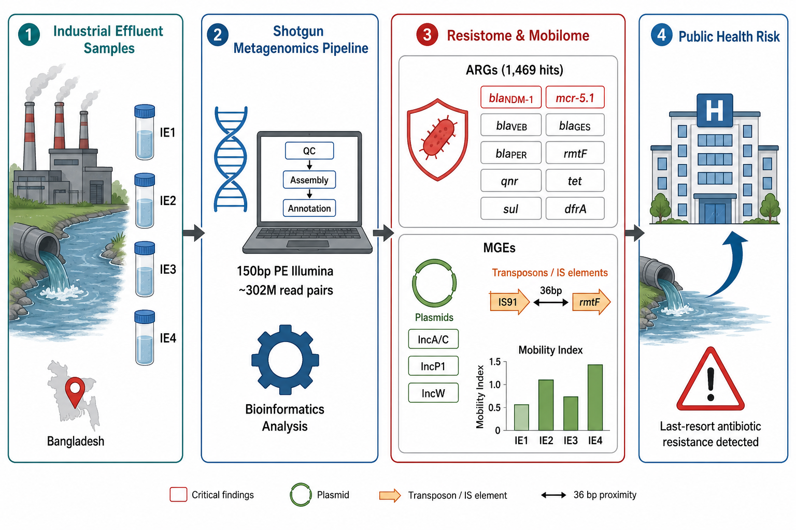

# Genomic Profiling of Extended-Spectrum ARGs and Mobilizable Resistance Determinants in Industrial Effluents

Shotgun metagenomic survey of antimicrobial resistance genes (ARGs) and mobile genetic elements (MGEs) in four industrial effluent samples (IE1–IE4) from Bangladesh.

## Workflow

fastp (QC) → MEGAHIT (assembly) → ABRicate (CARD, ResFinder, NCBI AMR, PlasmidFinder, VFDB) + ISEScan → ARG–MGE co-localization and Mobility Index

## Key findings

- **1,469 ARG hits** across 15 drug classes. IE4 has the most unique genes (228); IE2 has the fewest (18).
- **Critical determinants:** *bla*NDM-1 and *mcr-5.1* (IE4), *rmtF* (IE4), and the ESBLs VEB, GES and PER.
- **Mobility:** broad-host-range plasmids (IncA/C, IncP1, IncW) in IE1, IE3 and IE4. *rmtF* sits 36 bp from an IS91 element.
- **Mobility Index** (raw): IE1 0.31, IE4 0.29, IE2 0.27, IE3 0.17.

Co-localization calls are putative because the short-read contigs are short (N50 3.3–5.4 kb).

## Repository

| Path | Contents |
|------|----------|
| `docs/` | Analysis report and literature review |
| `figures/` | Graphical abstract, ARG heatmap, key genes, Mobility Index |
| `tables/` | ARG, MGE and virulence hits, co-localization, Mobility Index |
| `qc/` | fastp and MultiQC reports |

## License

MIT. See [LICENSE](LICENSE).
